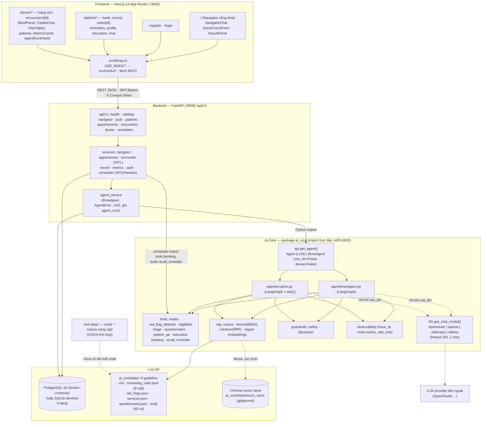
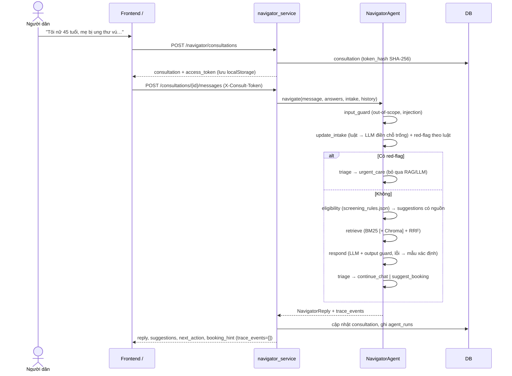
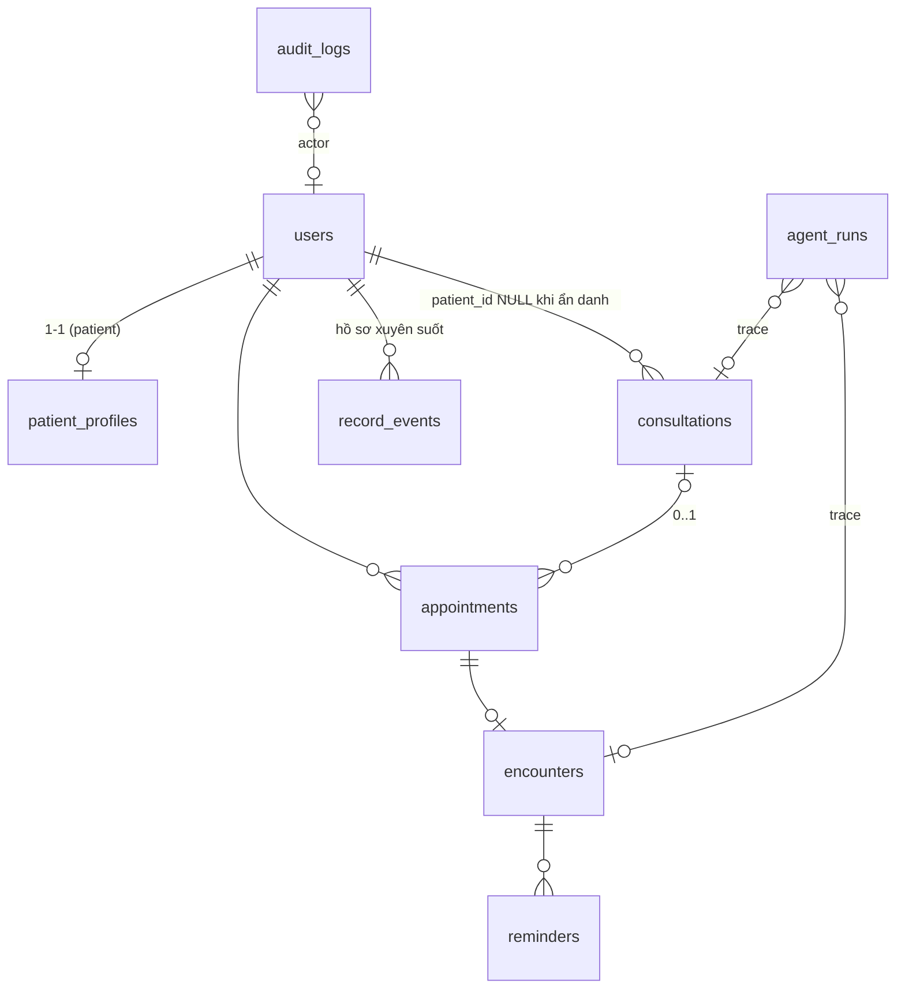

# OncoScreen AI — Tổng quan dự án & Tiến độ phát triển

> **Ngày rà soát:** 04/11/2026 · **Nhánh:** `feature/be-foundation-and-hitl` (trỏ cùng commit với `main` = `86b8ac4`)
> **Phương pháp:** đọc toàn bộ docs, source 3 khối, migration, Git history (36 commit, PR #1–#12), và **chạy lại** test/lint/build/eval/migration trên máy local ngày 04/11/2026.
> **Quy ước bằng chứng:** `đường/dẫn/file.py:dòng`, mã commit rút gọn (`3e9bcdb`), số PR (`#9`).
> Báo cáo **không** sửa source code. Mọi nhận định "đã chạy được" đều kèm lệnh đã chạy ở §10.

---

## 1. Executive Summary

| Câu hỏi | Trả lời ngắn |
|---|---|
| **Hệ thống là gì?** | Trợ lý AI cho **hành trình tầm soát ung thư** tại một bệnh viện (đồ án học phần, chạy local). Hai agent dùng chung một lõi tri thức: **Navigator** (người dân, ẩn danh) và **Clinical Copilot** (bác sĩ). AI **không chẩn đoán**. |
| **Mục tiêu cuối cùng** | Người dân biết nên tầm soát loại ung thư nào, khi nào, bao lâu một lần (có nguồn) → tạo tài khoản, đặt lịch → bác sĩ khám với bản tóm tắt hồ sơ do Copilot soạn → **bác sĩ sửa và duyệt** kế hoạch (HITL) → bệnh nhân nhận kết luận, kế hoạch, nhắc lịch tái tầm soát. |
| **Đã làm được gì** | MVP đủ 4 giai đoạn hành trình, chạy end-to-end ở **chế độ MockAgent** (pipeline thật, không gọi LLM): 34 endpoint REST, 9 bảng DB + 2 migration Alembic, 16 trang Next.js, 2 agent LangGraph, RAG lai BM25 + vector + RRF, luật tầm soát có nguồn, guardrail vào/ra, HITL, tracing, golden-set eval. **136 test AI Core + 34 test backend pass; build frontend pass.** |
| **Các giai đoạn** | (1) Dựng khung + contract (09/2026) → (2) MVP theo đề bài gốc "screening session" (đầu–giữa 10/2026) → (3) **Đổi scope lớn** sang Navigator → Copilot (27/10, PR #9) → (4) Gia cố an toàn toàn hệ thống (30/10, PR #12) + thu thập dữ liệu mở rộng (`vinh-data/`, PR #11). |
| **Thành phần quan trọng đã xong** | Eligibility engine theo luật, red-flag ngắt luồng, HITL finalize có guardrail, hồ sơ xuyên suốt `record_events`, phân quyền & cô lập dữ liệu bệnh nhân, fallback xác định khi LLM lỗi. |
| **Đang tập trung vào** | Không có commit mới sau 30/10. Thay đổi chưa commit cho thấy đang (a) làm cho dự án chạy được trên Windows (`scripts/dev-all.ps1`), (b) mở rộng nguồn dữ liệu sang 10 loại ung thư + hướng dẫn Bộ Y tế (`docs/CANCER_SCREENING_DATA_SOURCES.md`, chưa track). Kho `vinh-data/` (59 MB) đã có nhưng **chưa được nối vào AI Core**. |
| **Vấn đề lớn nhất chưa giải quyết** | (1) Chế độ **LLM thật chưa được nghiệm thu** end-to-end và chưa có số đo eval `--real`; (2) 8 guideline đều `review_status: draft`, chủ yếu của Mỹ, chưa có bác sĩ duyệt; (3) `vinh-data/` chưa tích hợp và có nội dung chẩn đoán cần lọc trước khi dùng; (4) frontend không có test tự động, chưa có test E2E xuyên FE–BE. |
| **Bước tiếp theo** | Chốt môi trường chạy (commit `dev-all.ps1`, sửa README, sửa lỗi encoding của `cli eval`) → nghiệm thu chế độ LLM thật + eval `--real` → lọc và tích hợp có chọn lọc `vinh-data/` (kèm quyết định mở rộng `CancerType`) → E2E test cho 4 kịch bản demo → đóng gói báo cáo. |

---

## 2. Project Introduction

### 2.1 Bài toán
- **Phía người dân:** nhiều người thuộc nhóm nguy cơ bỏ lỡ tầm soát định kỳ vì không biết nên tầm soát loại nào, từ tuổi nào, bao lâu một lần; ngại đến viện khi chưa rõ có cần khám không.
- **Phía bệnh viện:** bác sĩ bắt đầu buổi khám với rất ít thông tin về người bệnh.
- Nguồn: `docs/00_OVERVIEW.md`. Đề bài gốc: `topic/Tài Liệu Đặc Tả & Thiết Kế Kỹ Thuật_ Hệ Thống AI Agent Tầm Soát Ung Thư.docx` (yêu cầu LangGraph + RAG + HITL + scheduler, chạy local, không deploy cloud).

### 2.2 Người dùng & nghiệp vụ

| Người dùng | Việc làm được trong hệ thống | Không được làm |
|---|---|---|
| Người dân (chưa đăng nhập) | Chat hoặc điền bảng hỏi nhanh với Navigator; nhận gợi ý tầm soát **theo nhóm** có nguồn; bị ngắt luồng và khuyên khám sớm nếu có dấu hiệu cảnh báo | Nhận chẩn đoán, đọc kết quả xét nghiệm, kế hoạch cá nhân |
| Bệnh nhân (đã có tài khoản) | Gắn phiên tư vấn vào tài khoản (hồ sơ điền sẵn), đặt/huỷ lịch, xem hồ sơ xuyên suốt, xem kết luận + kế hoạch **đã duyệt**, hỏi đáp về kế hoạch, đánh dấu đã tầm soát | Xem brief, bản nháp, ghi chú nội bộ, trace AI |
| Bác sĩ | Hàng chờ (khẩn lên đầu), xác nhận lịch, bắt đầu khám → brief của Copilot, hỏi Copilot có trích dẫn, sửa kế hoạch + điền ngày hẹn, viết kết luận, **duyệt**; xem dashboard quan sát AI | Để AI tự gửi kết quả cho bệnh nhân |

### 2.3 Phạm vi hiện tại
- **Trong phạm vi và đã có code:** toàn bộ mục `[x]` trong `docs/00_OVERVIEW.md` (Navigator, claim phiên, đặt lịch mô phỏng, Copilot + HITL, hồ sơ xuyên suốt, nhắc lịch, RAG lai, guardrail, tracing, golden set).
- **Nâng cao, chưa làm:** LLM-as-judge, golden set ≥100 ca có bác sĩ gán nhãn, exporter Langfuse/OpenTelemetry, guideline Bộ Y tế, reranker, SMS/Zalo, HIS/EMR.
- **Ngoài phạm vi (cố ý không làm):** chẩn đoán/diễn giải kết quả/tư vấn điều trị, deploy cloud, multi-tenant, thanh toán.

### 2.4 Ràng buộc an toàn S1–S6 (bất biến)
S1 không chẩn đoán · S2 mọi gợi ý có nguồn, con số do luật sinh · S3 red-flag ngắt luồng trước LLM/RAG · S4 kế hoạch chỉ hiệu lực sau khi bác sĩ duyệt · S5 bảo mật PHI · S6 luôn kèm disclaimer. Bảng nơi thực thi: `docs/00_OVERVIEW.md` §"Ràng buộc an toàn".

---

## 3. System Architecture

### 3.1 Kiến trúc thực tế (dựng lại từ code)

Nét liền = luồng đang chạy ở chế độ mặc định (mock). Nét đứt = chỉ chạy khi bật LLM/vector store, hoặc chưa tồn tại.

### 3.2 Ranh giới & contract

| Ranh giới | Cơ chế | Nguồn sự thật |
|---|---|---|
| FE ↔ BE | REST JSON; JWT Bearer; `X-Consult-Token` cho phiên ẩn danh | `docs/protocols/API_CONTRACT.md` ↔ `frontend/src/types/api.ts` |
| BE ↔ AI Core | Gọi hàm Python trong threadpool (`backend/app/services/agent_service.py`) | `docs/protocols/AI_CORE_CONTRACT.md` ↔ `ai_core/ai_core/schemas.py` |
| BE ↔ DB | SQLAlchemy 2 ORM; SQLite `create_all` lúc startup, Postgres qua Alembic (`backend/app/database.py`, `backend/app/main.py:17-21`) | `docs/protocols/DB_SCHEMA.md`, `backend/app/models/` |
| AI Core ↔ tri thức | Markdown + frontmatter → BM25 trong bộ nhớ + Chroma tuỳ chọn | `ai_core/data/guidelines/` |

Đã đối chiếu: **mọi đường dẫn gọi trong `frontend/src/lib/api.ts` đều có endpoint tương ứng ở backend** (34 endpoint).

### 3.3 Kiến trúc hiện có vs dự kiến

| Hạng mục | Đang tồn tại | Dự kiến / chưa có |
|---|---|---|
| Triển khai | 1 process backend (import AI Core) + Next dev server + Postgres trong Docker hoặc SQLite | Tách AI Core thành service riêng (ADR-0002 nói chỉ cần bọc `ai_core.api`), chưa làm |
| LLM | Factory 4 provider, mặc định mock | Nghiệm thu với provider thật, LLM đặt trong hạ tầng bệnh viện (05 §8) |
| Quan sát | Log JSON + bảng `agent_runs` + `/doctor/metrics` | Exporter Langfuse/OTel qua `observability.add_sink` |
| Tri thức | 8 tài liệu → 31 chunk | Tích hợp `vinh-data/` (76 tài liệu song ngữ trong manifest), guideline Bộ Y tế, 10 loại ung thư |
| Thông báo | Chỉ đổi trạng thái `scheduled → due` | SMS/Zalo |

---

## 4. Technology Stack

| Lớp | Công nghệ (phiên bản đã cài trong `.venv` / `package.json`) | Ghi chú |
|---|---|---|
| Frontend | Next.js **14.2.15**, React 18.3.1, TypeScript strict, Tailwind 3.4, lucide-react | Mock API offline trong `src/mocks/` (engine 906 dòng, handlers 1 174 dòng) |
| Backend | FastAPI 0.159, SQLAlchemy 2.1, Pydantic v2 (2.14), pydantic-settings, Alembic 1.20, APScheduler 3.11, bcrypt, python-jose (JWT HS256), psycopg 3 | `backend/requirements.txt` |
| AI Core | LangGraph 1.2, langchain-core 1.6, langchain-openai / langchain-anthropic, ChromaDB 1.5, sentence-transformers 6.2 (`paraphrase-multilingual-MiniLM-L12-v2`) | BM25 viết thuần Python (`rag/lexical.py`) |
| DB | PostgreSQL 16 (`docker-compose.yml`), SQLite cho dev/test | |
| LLM | `LLM_PROVIDER` = openrouter (mặc định) / openai / anthropic / ollama | `ai_core/ai_core/llm.py` |
| Công cụ | ruff, pytest, ESLint (next lint), GitHub Actions (`.github/workflows/ci.yml`) | CI dùng Python 3.11, Node 20 |
| Môi trường local thực tế | Windows 11, `.venv` ở **thư mục gốc** repo, Python **3.13.5** | Khác với README (xem §11) |

---

## 5. Development Timeline

Tác giả lấy theo tên commit Git (không suy diễn vai trò ngoài những gì docs ghi). Ngày theo `git log --date=short`.

| Giai đoạn | Thời gian | Công việc | Kết quả đạt được | Bằng chứng |
|---|---|---|---|---|
| **GĐ 1 — Dựng khung & contract** | 14/09 – 22/09/2026 | Tạo monorepo 3 khối; viết toàn bộ docs, protocol, ADR, CI, CODEOWNERS; skeleton AI Core (schemas, MockAgent, LangGraph/RAG skeleton), backend (models, auth, sessions, HITL, reminders), frontend (types mirror, mock client); sau đó chốt contract + lộ trình 5 tuần | 153 file / 11 211 dòng; contract FE–BE–AI đồng bộ; roadmap 5 tuần | `bea64bf`, `13a80ff`, `ceb6986` (sửa lint CI); `docs/ROADMAP_5_TUAN.md`, `docs/adr/0001…0003` |
| **GĐ 2 — Frontend tuần 1–3** | 30/09/2026 | Trang survey động, profile, results, reminders, doctor queue/session review | 19 file, +2 635 dòng FE | `a77da05` "Tuần 1 2 3", merge PR #1 (`f5fa09e`, 06/10) |
| **GĐ 3 — Gia cố AI baseline & Backend nền** | 03/10 – 14/10/2026 | AI: FILE_MAP, xử lý lỗi, questionnaire `depends_on`. BE: migration Alembic đầu tiên `e4ae8d137edf` (5 bảng), profile API, test merge answers. AI: hoàn thiện MockAgent, hướng dẫn thu thập guideline, cấu trúc `raw_data` | Có migration DB; MockAgent đủ 3 ca chuẩn | `d7554ab` (PR #2), `706f4eb` (PR #3), `448863a` (PR #4), `a5907c9`/`1d455a9` (PR #5), `47c0904` (PR #6) |
| **GĐ 4 — Agent thật (phiên bản đầu) + chat bệnh nhân** | 15/10/2026 | Node LangGraph assess_risk/recommend/retrieve, RAG ingest/retriever, patient QA, endpoint chat/education, grounded generation test, fallback khi LLM lỗi | Luồng bệnh nhân → AI → bác sĩ duyệt theo mô hình `screening_sessions` | `2d5dbcb` (PR #7, 66 file) |
| **GĐ 5 — UI/UX lâm sàng** | 17/10/2026 | Đặc tả thiết kế `frontend/SKILL.md`; refactor toàn bộ UI; icon Lucide, `prefers-reduced-motion`, touch target 42–44px, bỏ empty state cụt | Giao diện thống nhất theo chuẩn | `f392e28`, `ca43a4d`, `33c8441` (PR #8) |
| **GĐ 6 — Tài liệu báo cáo** | 22/10/2026 | So sánh agent vs chatbot, đề cương `.docx` | | `0fde0d1` |
| **GĐ 7 — ĐỔI SCOPE LỚN** | **27/10/2026** | Thay mô hình "bảng hỏi → AI soạn kế hoạch → duyệt" bằng hành trình **Navigator → đặt lịch → Clinical Copilot → theo dõi**. Xoá `graph/`, `screening_recommender`, `session_service`, `hitl_service`, bảng `screening_sessions`; thêm 2 agent mới, eligibility engine + `screening_rules.json`, triage, intake, hybrid RAG + RRF, observability, evaluation + golden set; BE thêm consultations/appointments/encounters/record_events/agent_runs, migration `7b3c9d2e1f40`; FE viết lại gần như toàn bộ (Navigator công khai, register gắn phiên, booking, record, doctor encounter + Copilot, metrics) | 185 file, +15 346 / −6 142 dòng. Kiến trúc hiện hành ra đời ở commit này | `3e9bcdb` (PR #9); ghi chú đổi scope ở đầu `docs/04_ROADMAP.md`, `docs/ROADMAP_5_TUAN.md` |
| GĐ 7b — Sửa lỗi sau đổi scope | 27/10/2026 | Không lấy tuổi người thân làm tuổi người dùng; guard chẩn đoán bỏ qua câu điều kiện | | `26c1e31` (PR #10) |
| **GĐ 8 — Dữ liệu mở rộng & slide** | 29/10/2026 | Crawl + chunk dữ liệu (USPSTF, NCI PDQ, NCCN MedGUIDE, NICE, QĐ 1514/BYT), corpus song ngữ vi/en, 490 ca eval NCCN, script map luật USPSTF; kịch bản slide giới thiệu | `vinh-data/` (189 file, +85 845 dòng) — **chưa có code nào trong `ai_core/` hay `backend/` tham chiếu tới** | `17d55ce` (PR #11, merge `86b8ac4`); `f70c8c2` |
| **GĐ 9 — Gia cố an toàn toàn hệ thống** | 30/10/2026 | AI: siết red-flag (phủ định, mẫu mới, triệu chứng người thân), intake (chủ ngữ người thân, NFC), output guard (bỏ dấu, khuyên điều trị, số viết bằng chữ), Copilot kiểm tra dữ kiện LLM, LLM timeout, `validate_plan` chỉ nhận `doc_id` hợp lệ, sửa luật gan theo AASLD; golden set 20→40, test 60→136. BE: chặn lách guardrail kế hoạch, siết máy trạng thái HITL, phân trang có giới hạn, từ chối `SECRET_KEY` yếu trên Postgres, nâng ưu tiên khi red-flag xuất hiện sau đặt lịch; test 18→34. FE: xử lý token hết hạn, đặt lịch ưu tiên đúng phiên, bổ sung Disclaimer, `SimpleMarkdown` thay `dangerouslySetInnerHTML`, chống tạo lịch trùng. Docs đồng bộ | Trạng thái hiện tại của code | `098f030`, `9b35a03`, `31b1a22`, `9eb0e10` (PR #12, merge `5bb9048`) |
| **Giai đoạn hiện tại** | 31/10 – 04/11/2026 | **Không có commit mới.** Thay đổi chưa commit: `scripts/dev-all.ps1` (dùng `.venv\Scripts\uvicorn.exe` ở gốc repo); file mới chưa track `docs/CANCER_SCREENING_DATA_SOURCES.md` (187 dòng, danh mục nguồn cho **10** loại ung thư gồm cả buồng trứng, dạ dày, vòm họng, tuyến giáp, kèm QĐ Bộ Y tế) | Đang chuẩn bị chạy trên Windows và mở rộng nguồn dữ liệu | `git status` |

Nhánh: local `feature/be-foundation-and-hitl` = `main` = `86b8ac4`; `origin/feature/be-foundation-and-hitl` vẫn dừng ở `706f4eb` (08/10) — nhánh remote này đã lỗi thời.

---

## 6. Completed Features & Modules

Thang trạng thái: NOT STARTED · PLANNED · IN PROGRESS · **IMPLEMENTED** (đã viết và tích hợp) · **VERIFIED** (đã có test/chạy xác nhận) · BLOCKED.
"VERIFIED (mock)" = xác nhận ở chế độ `MockAgent`; **không** bao hàm chế độ LLM thật.

### 6.1 AI Core (`ai_core/`, 3 458 dòng Python)

| Module | Mục đích & cách hoạt động | Input → Output | Trạng thái | Còn thiếu |
|---|---|---|---|---|
| **Navigator Agent** `agents/navigator.py` | LangGraph `input_guard → update_intake ─(red-flag)→ triage` / `→ eligibility → [retrieve] → respond → triage` (`navigator.py:131-157`). Red-flag tính bằng luật trước mọi lời gọi LLM (`:217-218`). LLM chỉ trích xuất phần còn thiếu và diễn giải; vi phạm → câu trả lời mẫu | `message, answers, IntakeProfile, history` → `NavigatorReply` (reply, sources, suggestions, risk_factors, red_flag, next_action, booking_hint, trace) | **VERIFIED (mock)** — 16 test + golden set 40/40. Nhánh LLM: **IMPLEMENTED**, test bằng LLM giả lập | Đo với LLM thật; retrieve không lọc giới/tuổi (§11) |
| **Clinical Copilot** `agents/copilot.py` | Graph `load_record → eligibility → retrieve → draft_brief → draft_plan`; dữ kiện phải trỏ về `event_id`, có red-flag thì không soạn kế hoạch. `ask()` (không phải graph): BM25 xếp hạng guideline + mốc hồ sơ, trả lời trích xuất hoặc LLM có whitelist trích dẫn | `PatientRecord` → `ClinicalBrief`; `question` → `QuestionAnswer` | **VERIFIED (mock)** — 8 test. LLM: **IMPLEMENTED** | Như trên |
| **Eligibility engine** `tools/eligibility.py` + `data/screening_rules.json` | 8 luật (vú 40–74/24 th; CTC 21–29/36 th, 30–65/60 th; ĐTT 45–75/12 th; phổi 50–80 + ≥20 gói-năm/12 th; TTL 55–69 quyết định chung; gan: xơ gan 6 th, viêm gan chưa xơ → trao đổi bác sĩ). Mỗi luật trỏ `doc_id` + `section`, sai → lỗi khi load | `IntakeProfile` → `suggestions[]`, `risk_factors[]` | **VERIFIED** — 8 test | Chỉ 6 loại ung thư; chưa có luật Bộ Y tế |
| **Intake extraction** `tools/intake.py` (363 dòng) | Luật tiếng Việt có/không dấu, phủ định, phân biệt "tôi" và người thân; LLM chỉ điền chỗ trống | text/answers → `IntakeProfile` tích luỹ | **VERIFIED** — 19 test | Chưa phủ hết cách diễn đạt (05 §9) |
| **Red-flag detector** `tools/red_flag_detector.py` + `data/red_flags.json` (6 nhóm) | Luật + phủ định; cờ không gỡ trong phiên | text/answers → `RedFlagResult` | **VERIFIED** — 11 test, recall 100% trên golden set | |
| **Triage** `tools/triage.py` + `data/services.json` | `continue_chat / suggest_booking / urgent_care` + dịch vụ gợi ý | state → `next_action`, `BookingHint` | **VERIFIED** | |
| **RAG lai** `rag/corpus.py, lexical.py, retriever.py, ingest.py, embeddings.py` | Chunk theo `## ` (400 từ, overlap 40) + header ngữ cảnh; BM25 âm tiết bỏ dấu + bigram; Chroma + MiniLM đa ngôn ngữ; RRF k=60; tự hạ về BM25 khi thiếu vector store | query (+ lọc giới/tuổi/loại) → `list[Source]` | Lexical: **VERIFIED** (6 test). Hybrid: **VERIFIED thủ công** ngày 04/11 (`mode=hybrid, dense=ok`, 31 chunk) | Reranker; kho chỉ 8 tài liệu |
| **Guardrails** `guardrails/safety.py` | Input: ngoài phạm vi, prompt injection. Output: ngôn ngữ chẩn đoán (bỏ dấu, bỏ qua câu điều kiện), khuyên điều trị, con số không có trong bằng chứng (kể cả số viết bằng chữ). `validate_plan` cho kế hoạch bác sĩ sửa | text → cờ / ngoại lệ `GuardrailViolation` | **VERIFIED** — 7 + 9 test | LLM-as-judge (nâng cao) |
| **Patient QA** `tools/patient_qa.py` | Chỉ trả lời trong phạm vi kế hoạch đã duyệt; red-flag → khuyên khám sớm | question + `ScreeningPlan` → `QuestionAnswer` | **VERIFIED** — 5 test | |
| **Education** `tools/education.py` | Bài giáo dục theo loại ung thư từ guideline | `CancerType` → `EducationContent` | **IMPLEMENTED** (có endpoint `/education`) | Chưa thấy test riêng |
| **Observability** `observability.py` | `trace_id`, wrapper `traced` ghi node/status/duration + thuộc tính an toàn; log JSON; `add_sink` | — | **IMPLEMENTED** (dữ liệu được lưu vào `agent_runs`) | Exporter thật: **PLANNED** |
| **Evaluation** `evaluation.py`, `cli.py eval` | 7 chỉ số trên golden set 40 ca | agent → report | **VERIFIED (mock)**: 40/40, recall 100%, FP 0%, triage 100%, suggestion 100%, citation 100%, diagnosis-language 0% | `--real` chưa có kết quả; **CLI lỗi encoding trên console Windows** (§11) |
| **LLM factory** `llm.py` | 4 provider, timeout 20 s, 1 lần thử lại | — | **IMPLEMENTED** | Chưa nghiệm thu với provider thật trong lần rà soát này |

### 6.2 Backend (`backend/`, 2 722 dòng Python)

| Module | Chức năng đã xây dựng | Trạng thái | Còn thiếu |
|---|---|---|---|
| **Navigator API** `api/v1/navigator.py`, `services/navigator_service.py` | Tạo phiên ẩn danh (token ngẫu nhiên, DB chỉ lưu SHA-256), gửi tin nhắn, đọc phiên, claim phiên; giới hạn 40 lượt/phiên (`navigator_service.py:21`); catalog `/services`, `/education`, `/navigator/questionnaire` | **VERIFIED** — 10 test | Chưa giới hạn số phiên tạo mới (§11) |
| **Auth** `api/v1/auth.py`, `core/security.py` | Đăng ký (chỉ role patient qua API), đăng ký kèm phiên tư vấn → gắn phiên + điền sẵn hồ sơ, đăng nhập JWT, `/auth/me`; bcrypt | **VERIFIED** — 4 test + test trong journey | Không có refresh token, đổi mật khẩu |
| **Patient profile & record** `api/v1/patients.py`, `services/record_service.py` | Hồ sơ nền; hồ sơ xuyên suốt `record_events` với `visibility` | **VERIFIED** — 2 test + journey | |
| **Appointments** `services/appointment_service.py` | Đặt lịch theo dịch vụ, `priority=urgent` nếu phiên có red-flag, huỷ (409 nếu đã bắt đầu khám), nâng ưu tiên khi red-flag xuất hiện sau khi đặt (`appointment.escalated`) | **VERIFIED** | Lịch/slot thật (mô phỏng có chủ đích) |
| **Encounters + HITL** `services/encounter_service.py` | `start` → sinh brief; `regenerate_brief`; `ask_copilot`; `finalize`: bắt buộc kết luận, lịch phải `confirmed`, chỉ bác sĩ đã bắt đầu khám, kế hoạch sửa phải qua `validate_plan` (400), audit khi khác bản nháp, sinh reminder; `to_out` ẩn brief/draft/notes với bệnh nhân | **VERIFIED** — 10+ test trong `test_journey.py` | |
| **Doctor API** `api/v1/doctor.py` | Hàng chờ phân trang (khẩn lên đầu), danh sách/hồ sơ bệnh nhân, metrics, agent-runs, reminders due | **VERIFIED** | |
| **Agent bridge** `services/agent_service.py` | Gọi AI Core trong threadpool, `AgentError` → 502 không lộ chi tiết, ghi `agent_runs` | **VERIFIED** (`test_agent_error_detail_is_not_leaked`) | |
| **Metrics** `services/metrics_service.py` | Số phiên, tỉ lệ red-flag, chuyển đổi, fallback rate, insufficient-evidence rate, p50/p95 latency | **IMPLEMENTED** | Chưa thấy test riêng cho số liệu |
| **Scheduler** `services/scheduler.py` | Tạo reminder từ kế hoạch; `complete` → `done` + sinh chu kỳ kế tiếp (an toàn khi tràn lịch); APScheduler `tick` đổi `scheduled → due` mỗi `REMINDER_TICK_SECONDS` | `complete`: **VERIFIED**. `tick`: **IMPLEMENTED** (không có test gọi `tick`) | Kênh thông báo thật: **PLANNED** |
| **Config** `config.py` | Đọc `.env` gốc; từ chối khởi động với `SECRET_KEY` mặc định/ngắn khi không phải SQLite | **VERIFIED** — 3 test | |

### 6.3 Frontend (`frontend/`)

| Khu vực | Trang / component | Trạng thái |
|---|---|---|
| Navigator công khai | `/` — `NavigatorChat`, `QuickCheckForm`, `ResultPanel`, `SuggestionCard`, `RedFlagAlert`, `SourceList` | **IMPLEMENTED** |
| Tài khoản | `/register` (gắn phiên), `/login`, `RoleGuard`, xử lý token hết hạn (`lib/auth.ts`, `lib/errors.ts`) | **IMPLEMENTED** |
| Bệnh nhân | `/patient`, `/patient/book`, `/patient/record`, `/patient/visits/[id]`, `/patient/reminders`, `/patient/profile`, `/patient/education`, `/patient/chat`; `PatientQuestionBox`, `PlanTable`, `RecordTimeline`, `Disclaimer` | **IMPLEMENTED** |
| Bác sĩ | `/doctor` (hàng chờ + `MetricsCards`), `/doctor/encounters/[id]` (`BriefPanel`, `CopilotChat`, `PlanTable`, `TraceEvents`), `/doctor/patients`, `/doctor/patients/[id]`, `AgentRunsPanel` | **IMPLEMENTED** |
| Mock offline | `src/mocks/engine.ts, fixtures.ts, handlers.ts` mô phỏng đủ 4 giai đoạn | **IMPLEMENTED** |

Toàn bộ frontend: `tsc --noEmit` sạch, `next lint` sạch, `next build` thành công (16 route) ngày 04/11. **Không có test tự động nào** → không xếp VERIFIED. Lần rà soát này cũng không thao tác UI trên trình duyệt.

### 6.4 Dữ liệu & tri thức

| Thành phần | Nội dung | Trạng thái |
|---|---|---|
| `ai_core/data/guidelines/` | 8 bản tóm tắt tiếng Việt (USPSTF ×5, WHO ×2, AASLD ×1) → 31 chunk; tất cả `review_status: draft` | **IMPLEMENTED**, chưa được bác sĩ duyệt |
| `ai_core/data/eval/navigator_cases.json` | 40 ca golden set | **VERIFIED** (chạy được) |
| `vinh-data/` | 76 tài liệu song ngữ vi/en trong `guidelines/_manifest.jsonl` (USPSTF, NCI PDQ, NCCN 2025, NICE, QĐ 1514/BYT), raw HTML/JSONL + `source.yaml`, 2 file parquet HF (CancerGov QA, MedGUIDE 8K), 490 ca eval NCCN, KB "clinical_diagnosis" (96 bản ghi triệu chứng từ QĐ 1514/BYT), 6 script crawl/convert, `uspstf_mapped_rules.json` | **IN PROGRESS** — đã thu thập, **chưa tích hợp** |
| `docs/CANCER_SCREENING_DATA_SOURCES.md` | Danh mục nguồn cho 10 loại ung thư | **PLANNED** (chưa commit) |

---

## 7. Current Development Status

### 7.1 Trả lời trực tiếp

| Câu hỏi | Trả lời |
|---|---|
| **Phần nào hoạt động hoàn chỉnh?** | Toàn bộ hành trình 4 giai đoạn ở **chế độ MockAgent** trên backend: Navigator → đăng ký gắn phiên → đặt lịch → bác sĩ start/brief/Copilot/finalize → bệnh nhân xem kết quả, hỏi đáp, hoàn thành reminder (`backend/tests/test_journey.py::test_full_journey`). Luồng red-flag (`test_red_flag_consultation_books_urgent_and_brief_has_no_plan`). |
| **Phần nào mới ở mức prototype?** | Chế độ LLM thật (có code, có test với LLM giả lập, chưa có số đo với LLM thật). Dense retrieval (chạy được local nhưng vector store phải ingest tay, không có trong repo). Dữ liệu y khoa (bản tóm tắt draft). |
| **Phần nào đã viết nhưng chưa tích hợp?** | `vinh-data/` (corpus, luật map USPSTF, 490 ca eval NCCN); `observability.add_sink` chưa có exporter nào. |
| **Phần nào demo được?** | (a) Full-stack FE + BE + MockAgent với tài khoản seed (`backend/scripts/seed.py`: `doctor@demo.vn`, `lan@demo.vn`, `hung@demo.vn`, mật khẩu `123456`). (b) Frontend một mình với `NEXT_PUBLIC_USE_MOCK_API=true`. (c) `python -m ai_core.cli demo` và `eval`. 4 kịch bản demo ở `docs/02_BUSINESS_FLOW.md`. |
| **Phần nào chưa dùng được?** | Thông báo nhắc lịch qua kênh thật; guideline Bộ Y tế; 4 loại ung thư mới (buồng trứng, dạ dày, vòm họng, tuyến giáp) — `CancerType` chỉ có 6 + `other` (`ai_core/ai_core/schemas.py:30-37`); triển khai ngoài máy dev. |
| **Phụ thuộc giữa các module** | FE phụ thuộc contract `types/api.ts`; BE import trực tiếp `ai_core.api`, `ai_core.schemas`, `ai_core.guardrails.safety.validate_plan`, `ai_core.tools.booking`, `ai_core.tools.recall_reminder` → **đổi `ai_core` có thể làm vỡ backend**; AI Core phụ thuộc `data/` (luật trỏ `doc_id` — đổi tên file guideline làm hỏng khi khởi động). |

### 7.2 Môi trường local đang dùng (khác `.env.example`)
- `.env` local: `DATABASE_URL=sqlite:///./dev.db`, **`USE_MOCK_AGENT=false`**, `LLM_PROVIDER=openrouter`, `LLM_MODEL=nvidia/nemotron-3-super-120b-a12b:free`, có `LLM_API_KEY`. Nghĩa là backend khởi động bằng `.env` này sẽ **gọi LLM bên ngoài**. Chỉ dùng hồ sơ giả khi chạy như vậy (README).
- `ai_core/data/vector_store/chroma.sqlite3` đã được ingest (27/10/2026) — chỉ có trên máy này (gitignored).

---

## 8. Core Business Workflows

### 8.1 Luồng 1 — Người dân hỏi Navigator (ẩn danh) → gợi ý có nguồn

### 8.2 Luồng 2 — Tạo tài khoản, đặt lịch, khám với Copilot (HITL)
1. `POST /auth/register` kèm `consultation_id` + token → gắn phiên, điền sẵn `patient_profiles`, ghi mốc `account.created`, `consult.summary`, (`red_flag.detected`).
2. `POST /appointments` → `requested`; `priority=urgent` nếu phiên có red-flag.
3. Bác sĩ `GET /doctor/appointments` (khẩn lên đầu) → `POST …/confirm` → `POST …/start`: tạo `encounter (in_progress)`, gọi `build_brief(PatientRecord)` → brief + bản nháp kế hoạch (không ngày hẹn; red-flag → không có kế hoạch).
4. Bác sĩ hỏi `POST /doctor/encounters/{id}/copilot` (câu hỏi chẩn đoán bị từ chối).
5. `POST …/finalize`: kết luận bắt buộc; kế hoạch sửa qua `validate_plan`; khác bản nháp → audit `plan.edit`; sinh reminder cho mục có ngày; lịch → `completed`; mốc `encounter.finalized`.

Máy trạng thái: `Appointment requested → confirmed → (start) → completed | cancelled`; `Encounter in_progress → finalized` (`docs/01_ARCHITECTURE.md` §Trạng thái, thực thi ở `encounter_service.py:84-215`).

### 8.3 Luồng 3 — Theo dõi sau khám
1. Bệnh nhân `GET /encounters/{id}` → chỉ thấy kết luận + kế hoạch đã duyệt + reminder khi `finalized` (`encounter_service.to_out`).
2. `POST /encounters/{id}/questions` → chỉ trả lời trong phạm vi kế hoạch (409 nếu chưa finalize).
3. APScheduler `tick` đổi reminder `scheduled → due`.
4. `POST /reminders/{id}/complete` → `done`, sinh chu kỳ kế tiếp, mốc `reminder.done` (Copilot dùng ở lần khám sau).

### 8.4 Luồng 4 — Red-flag
"Em sờ thấy khối cứng ở vú" → ngắt tư vấn, `urgent_care`, không có `suggestions` (invariant trong `schemas.py`) → lịch `urgent` lên đầu hàng chờ → brief không có kế hoạch tầm soát định kỳ. Đã có test ở cả AI Core và backend.

---

## 9. Database & Infrastructure

### 9.1 Schema hiện hành (9 bảng)

Chi tiết cột: `docs/protocols/DB_SCHEMA.md`, `backend/app/models/*.py`. JSON (`intake`, `brief`, `draft_plan`, `final_plan`, `last_reply`) lưu nguyên `model_dump(mode="json")` của `ai_core.schemas`.

### 9.2 Migration
- `e4ae8d137edf_init.py` (08/10): 5 bảng của mô hình cũ (`users`, `patient_profiles`, `screening_sessions`, `audit_logs`, `reminders`).
- `7b3c9d2e1f40_navigator_copilot_journey.py` (27/10): **drop** `reminders`, `audit_logs`, `screening_sessions` rồi tạo lại theo mô hình mới → nâng cấp sẽ **mất dữ liệu** của các bảng đó (chấp nhận được vì chưa có dữ liệu thật).
- Đã chạy `alembic upgrade head` trên SQLite trống: thành công; `alembic check`: "No new upgrade operations detected" (model khớp migration). **Chưa chạy trên PostgreSQL** trong lần rà soát này.

### 9.3 Hạ tầng
- `docker-compose.yml`: chỉ PostgreSQL 16 (user/pass `postgres/postgres`, chỉ dành cho dev).
- Chạy: `Makefile` (Linux/macOS), `scripts/dev-all.ps1` (Windows, đang sửa chưa commit).
- CI `.github/workflows/ci.yml`: ruff + pytest AI Core + pytest backend (SQLite, MockAgent) + `npm ci`, lint, build FE. Không có job E2E, không chạy Alembic, không chạy Postgres.
- Không có Dockerfile cho ứng dụng; không deploy (ngoài phạm vi theo đề bài).

---

## 10. Testing & Verification

### 10.1 Kết quả chạy lại ngày 04/11/2026 (Windows 11, Python 3.13.5, Node `frontend/node_modules` Next 14.2.15)

| Kiểm tra | Lệnh | Kết quả |
|---|---|---|
| AI Core unit test | `cd ai_core && pytest -q` (đặt `LLM_API_KEY=""`, `USE_MOCK_AGENT=true`) | ✅ **136 passed** (14,5 s) |
| Backend test | `cd backend && pytest -q` (conftest tự dùng SQLite `test.db` + MockAgent) | ✅ **34 passed** (26 s) |
| Lint Python | `ruff check ai_core backend` | ✅ All checks passed |
| Golden-set eval | `cd ai_core && python -m ai_core.cli eval` | ❌ `UnicodeEncodeError` (cp1252) trên console Windows → ✅ chạy lại với `PYTHONIOENCODING=utf-8`: 40 ca, mọi chỉ số đạt ngưỡng, latency TB 5,0 ms |
| Typecheck FE | `npx tsc --noEmit` | ✅ không lỗi |
| Lint FE | `npm run lint` | ✅ No ESLint warnings or errors |
| Build FE | `npm run build` (`NEXT_PUBLIC_USE_MOCK_API=true`) | ✅ 16 route |
| Migration | `alembic upgrade head` + `alembic check` trên SQLite tạm | ✅ |
| RAG hybrid | `retrieve(..., dense=True)` với vector store local, chế độ offline HF | ✅ `mode=hybrid`, `dense=ok`, trả về `lung_uspstf_2021` |

### 10.2 Độ phủ
- **Có:** luật, intake, red-flag, guardrail vào/ra, fallback khi LLM bịa nguồn/bịa số/chẩn đoán/lỗi/treo (LLM giả lập), schemas, retriever, hành trình backend đầy đủ, phân quyền, cô lập bệnh nhân, máy trạng thái, audit, phân trang, cấu hình bí mật.
- **Không có:** test frontend (không có script `test`, không có file test); E2E trình duyệt xuyên FE–BE (`puppeteer` có trong `devDependencies` nhưng không có code nào dùng); test `scheduler.tick`; test `metrics_service`; eval với LLM thật; test trên PostgreSQL.
- Không tìm thấy log chạy hay báo cáo test cũ nào được lưu trong repo.

---

## 11. Known Issues & Technical Debt

Chỉ liệt kê vấn đề có bằng chứng trong repo hoặc đã tái hiện được.

| # | Mức | Vấn đề | Bằng chứng |
|---|---|---|---|
| 1 | **HIGH** | **Chế độ LLM thật chưa được nghiệm thu.** Chưa có kết quả `eval --real`; docs tự ghi "chưa đo trên agent thật với bộ ca lớn". Trong khi đó `.env` local đặt `USE_MOCK_AGENT=false` với model miễn phí → hành vi demo có thể khác kết quả test | `docs/05_AGENT_RELIABILITY.md` §9; `.env` |
| 2 | **HIGH** | **Nội dung y khoa chưa được duyệt:** 8/8 guideline `review_status: draft`; chủ yếu nguồn Mỹ; chưa có hướng dẫn Bộ Y tế | `ai_core/data/guidelines/*.md`; `ai_core/data/guidelines/README.md` |
| 3 | **HIGH** | **`vinh-data/` chưa tích hợp và cần lọc trước khi dùng:** có KB "clinical_diagnosis" (triệu chứng/chẩn đoán từ QĐ 1514), bộ eval NCCN gồm xử trí nốt phổi/Lung-RADS (diễn giải kết quả — trái S1 nếu đưa cho Navigator), và các file KB sinh bởi LLM (`claude_opus_knowledge_base.json`, `gemini_*`) cần kiểm chứng xuất xứ. `doc_id` dạng `lung-uspstf-2021-screening-vn` khác quy ước `lung_uspstf_2021` mà `screening_rules.json` trỏ tới | `vinh-data/`, `vinh-data/evaluation/README.md`; `grep` không có tham chiếu nào từ `ai_core/` |
| 4 | **HIGH** | **Không có test frontend và E2E.** Thay đổi UI an toàn (Disclaimer, ẩn brief) chỉ được bảo vệ ở tầng backend | §10.2 |
| 5 | MEDIUM | **Navigator không lọc metadata khi truy xuất** — `retrieve()` được gọi không kèm `gender`/`age` (Copilot `ask()` cũng vậy), trái với mô tả "lọc metadata trước" trong docs. Có thể trích dẫn guideline không áp dụng cho giới/tuổi người hỏi | `ai_core/ai_core/agents/navigator.py:249`, `agents/copilot.py:346` vs `docs/05_AGENT_RELIABILITY.md` §3.3 |
| 6 | MEDIUM | **`python -m ai_core.cli eval` (và có thể `demo`) lỗi trên console Windows** do in tiếng Việt với encoding cp1252 (`seed.py` đã tự `reconfigure` nhưng `cli.py` thì không) | Đã tái hiện; `ai_core/ai_core/evaluation.py:111` |
| 7 | MEDIUM | **Hướng dẫn chạy không khớp môi trường thực tế:** README nói `ai_core/.venv` (Python 3.12.3, lệnh Linux), thực tế `.venv` ở gốc repo, Python 3.13.5, Windows; bản sửa `scripts/dev-all.ps1` chưa commit | `README.md` §"Chạy dự án local"; `git status` |
| 8 | MEDIUM | **Không giới hạn số phiên tư vấn ẩn danh được tạo.** Giới hạn 40 lượt chỉ áp cho từng phiên; `POST /navigator/consultations` công khai, không có rate limit → có thể làm tốn chi phí LLM khi bật agent thật | `backend/app/services/navigator_service.py:21,77`; không có thư viện rate-limit trong `backend/app` |
| 9 | MEDIUM | **Mở rộng 10 loại ung thư cần đổi contract**: `CancerType` chỉ có 6 + `other`; đổi phải đồng bộ `schemas.py`, `types/api.ts`, 2 file contract (CLAUDE.md) | `ai_core/ai_core/schemas.py:30-37`; `docs/CANCER_SCREENING_DATA_SOURCES.md` |
| 10 | MEDIUM | **Hiệu năng RAG khi kho lớn:** mỗi truy vấn dựng lại BM25 trên toàn bộ chunk và mở lại `chromadb.PersistentClient`. Không đáng kể với 31 chunk, sẽ đáng kể khi nạp `vinh-data/` | `ai_core/ai_core/rag/retriever.py:81, 54` |
| 11 | LOW | **File SQLite cũ/lẫn lộn:** `./dev.db` ở gốc repo còn schema cũ (`screening_sessions`…, ngày 22/10); `backend/dev.db` chứa cả bảng cũ `screening_sessions` lẫn bảng mới. Đường dẫn `sqlite:///./dev.db` phụ thuộc thư mục đang chạy | Đọc read-only `sqlite_master` của 2 file |
| 12 | LOW | `scheduler.tick` và `metrics_service` không có test | §10.2 |
| 13 | LOW | Token JWT và token phiên lưu `localStorage` (docs ghi "đủ cho demo local") | `frontend/src/lib/auth.ts:1`, `lib/consult.ts` |
| 14 | LOW | Tài liệu lịch sử dễ gây nhầm: `docs/04_ROADMAP.md`, `docs/ROADMAP_5_TUAN.md` mô tả luồng `screening_sessions` đã bỏ (đã có ghi chú đầu file) | |
| 15 | LOW | Quản trị repo: `CODEOWNERS` dùng handle giả (`@tuyen`, `@backend-dev`, `@frontend-dev`); bảng phân công trong `00_OVERVIEW.md` còn "_(điền tên)_"; nhánh remote `origin/feature/be-foundation-and-hitl` dừng ở 08/10 | `.github/CODEOWNERS`, `docs/00_OVERVIEW.md` |
| 16 | LOW | `vinh-data/` (59 MB, gồm parquet 7,6 MB và PDF) commit thẳng vào Git, làm repo nặng | `du -sh vinh-data` |
| 17 | LOW | `puppeteer` trong `devDependencies` nhưng không được dùng | `frontend/package.json` |

**Giải pháp tạm thời có chủ đích (không phải lỗi):** đặt lịch mô phỏng (không có slot), reminder chỉ đổi trạng thái, `MockAgent` cho dev/CI, fallback BM25 khi thiếu vector store, SQLite cho dev.

---

## 12. Remaining Tasks

| Nhóm | Việc còn thiếu |
|---|---|
| Hoàn thiện dang dở | Commit `dev-all.ps1`; quyết định số phận `docs/CANCER_SCREENING_DATA_SOURCES.md`; lọc/tích hợp `vinh-data/` |
| Sửa lỗi | Encoding CLI trên Windows; lọc metadata ở Navigator retrieve |
| Tích hợp | Corpus `vinh-data` → `ai_core/data/guidelines`; 490 ca NCCN → bộ eval Copilot (sau khi lọc); exporter observability |
| Nghiệm thu | Eval `--real`; demo đủ 4 kịch bản với LLM thật; chạy trên PostgreSQL |
| Kiểm thử | E2E FE–BE; test `scheduler.tick`, `metrics_service` |
| Nội dung y khoa | Bác sĩ duyệt guideline (`review_status`), bổ sung Bộ Y tế |
| Đóng gói | README khớp môi trường; báo cáo, slide, video demo (Tuần 5 của roadmap) |

---

## 13. Development Roadmap

Thứ tự ưu tiên theo yêu cầu: dang dở → lỗi → tích hợp → luồng chính → kiểm thử → hiệu năng/kiến trúc → mở rộng. Không đề xuất làm lại phần đã ổn.

| # | Công việc | Mục tiêu & lý do | Module | Cần xong trước | Tiêu chí nghiệm thu |
|---|---|---|---|---|---|
| 1 | **Chốt môi trường chạy local** | Ai clone repo cũng chạy được trên Windows/Linux; hiện README sai đường dẫn venv (#7) | `scripts/`, `README.md` | — | Commit `dev-all.ps1`; README ghi đúng vị trí `.venv` và Python ≥3.11; làm theo README từ máy sạch chạy được seed + backend + frontend |
| 2 | **Sửa encoding CLI** (#6) | `cli eval`/`demo` là công cụ demo/báo cáo, đang lỗi trên Windows | `ai_core/cli.py` | — | `python -m ai_core.cli eval` chạy được trên console Windows mặc định |
| 3 | **Lọc metadata ở Navigator retrieve** (#5) | Đúng với thiết kế trong docs; tránh trích dẫn guideline không áp dụng | `ai_core/agents/navigator.py` | — | Truyền `gender`/`age` từ intake; thêm test: nam hỏi chung không nhận nguồn chỉ dành cho nữ; 136 test + eval vẫn pass |
| 4 | **Nghiệm thu chế độ LLM thật** (#1) | Kiểm chứng agent thật an toàn như mock; có số liệu cho báo cáo | `ai_core`, `backend` | 1 | `eval --real` trên 40 ca đạt: red-flag recall 100%, citation 100%, diagnosis-language 0%; ghi kết quả + model + ngày vào `05_AGENT_RELIABILITY.md`; chạy 4 kịch bản demo với `USE_MOCK_AGENT=false`, ghi tỉ lệ fallback |
| 5 | **Lọc và tích hợp `vinh-data/`** (#3, #10) | Mở rộng tri thức có nguồn mà không vi phạm S1 | `ai_core/data`, `ai_core/rag` | 3; quyết định của nhóm về phạm vi | Chỉ nạp tài liệu **tầm soát** (loại KB chẩn đoán/xử trí ra khỏi Navigator); `doc_id` theo quy ước hiện có; `screening_rules.json` vẫn load được; eval không giảm; cache BM25 nếu số chunk lớn |
| 6 | **Quyết định mở rộng `CancerType`** (#9) | `CANCER_SCREENING_DATA_SOURCES.md` nói 10 loại, code có 6 | Contract (3 khối) | 5 | PR `contract/*` cập nhật đồng bộ `schemas.py`, `types/api.ts`, 2 file contract + luật có nguồn cho từng loại mới, hoặc ghi rõ quyết định không mở rộng |
| 7 | **E2E test cho 4 kịch bản demo** (#4) | Bảo vệ luồng chính và quy tắc hiển thị S4/S6 ở tầng UI | `frontend` (+ BE seed) | 1 | Script E2E (Playwright/Puppeteer — puppeteer đã có trong devDeps) chạy 4 kịch bản ở `02_BUSINESS_FLOW.md`; có thể chạy trong CI với MockAgent |
| 8 | **Bổ sung test còn thiếu** (#12) + chạy trên PostgreSQL | Đóng lỗ hổng kiểm thử; DB đích là Postgres | `backend` | — | Test `scheduler.tick`, `metrics_service`; `alembic upgrade head` + test backend pass trên Postgres (có thể thêm service Postgres vào CI) |
| 9 | **Rate limit tạo phiên ẩn danh** (#8) | Ngăn lạm dụng chi phí LLM khi bật agent thật | `backend` | 4 | Giới hạn theo IP/khoảng thời gian; test 429 |
| 10 | **Bác sĩ duyệt guideline + bổ sung Bộ Y tế** (#2) | Điều kiện để nội dung đáng tin | `ai_core/data` | 5 | `review_status` đổi sau khi có người duyệt (ghi tên/ngày); có ít nhất 1 nguồn Bộ Y tế cho mỗi loại ung thư đang hỗ trợ |
| 11 | Dọn dẹp repo (#11, #14–#17) | Giảm nhầm lẫn cho người tiếp nhận | toàn repo | — | Điền CODEOWNERS/phân công thật; xoá nhánh remote cũ; cân nhắc Git LFS hoặc tách `vinh-data/raw_data`; bỏ `dev.db` cũ |
| 12 | Mở rộng (nâng cao) | Theo danh sách "Nâng cao" của `00_OVERVIEW.md` | — | 4, 10 | Exporter Langfuse/OTel qua `add_sink`; LLM-as-judge; golden set ≥100 ca có bác sĩ gán nhãn; reranker |

---

## 14. Overall Assessment

| Thành phần | Đã làm được | Còn thiếu | Trạng thái |
|---|---|---|---|
| **AI Core — luật & an toàn** (eligibility, intake, red-flag, triage, guardrail) | Rules-first, có nguồn, fail-safe, test dày | Mở rộng diễn đạt tiếng Việt, luật Bộ Y tế | **VERIFIED** |
| **AI Core — agent LLM** | 2 graph LangGraph, structured output, whitelist trích dẫn, kiểm tra con số, timeout | Nghiệm thu với LLM thật | **IMPLEMENTED** |
| **RAG** | Hybrid BM25 + Chroma + RRF, fallback | Lọc metadata ở Navigator, kho tri thức lớn hơn, reranker | **VERIFIED** (lexical), hybrid xác nhận thủ công |
| **Backend** | 34 endpoint, HITL, phân quyền, audit, agent_runs, metrics | Rate limit, test tick/metrics | **VERIFIED** (SQLite + MockAgent) |
| **Frontend** | 16 trang, 3 cổng, mock offline, xử lý lỗi/phiên | Test tự động | **IMPLEMENTED** (build/lint/typecheck pass) |
| **Database** | 9 bảng, 2 migration khớp model | Chạy trên Postgres chưa được xác nhận lần này | **VERIFIED** (SQLite) |
| **Business logic (hành trình 4 giai đoạn)** | Đủ luồng chính + red-flag + theo dõi | Kênh thông báo thật | **VERIFIED** (mock, tầng API) |
| **Dữ liệu y khoa** | 8 bản tóm tắt + 40 ca eval; `vinh-data/` đã thu thập | Bác sĩ duyệt, tích hợp, Bộ Y tế | **IN PROGRESS** |
| **External services** | Factory 4 LLM provider | Nghiệm thu thực tế; exporter observability | **IMPLEMENTED** / exporter **PLANNED** |
| **Testing** | 170 test Python pass, CI | FE test, E2E, Postgres, eval thật | **IN PROGRESS** |
| **Deployment** | docker-compose cho Postgres, script dev | Không có (ngoài phạm vi theo đề bài) | **NOT STARTED** (cố ý) |

**Nhận định chung.** Dự án đã đi qua một lần đổi scope lớn (27/10) và đã ổn định lại: kiến trúc hiện tại nhất quán giữa docs, contract và code, có test dày ở các lớp an toàn quan trọng nhất. Đây là một **MVP demo được ở chế độ mock**, có thể trình bày đủ 4 kịch bản. Khoảng cách lớn nhất trước khi coi là "hoàn thành" không nằm ở tính năng mà ở **nghiệm thu**: (1) chạy và đo với LLM thật, (2) nội dung y khoa được duyệt, (3) kiểm thử tầng UI/E2E. Hướng mở rộng dữ liệu (`vinh-data/`, 10 loại ung thư) đang có động lực nhưng cần quyết định phạm vi và lọc an toàn trước khi tích hợp, vì một phần dữ liệu thu thập được thuộc vùng chẩn đoán/xử trí mà hệ thống cam kết không làm.

---

## 15. Tiến độ triển khai theo §13 (cập nhật 05/11/2026)

> Nhánh `feature/plan-execution-nov` (tách từ `86b8ac4`), **chưa commit**. Phạm vi lần này: task #1, #2, #3, #7, #8, #9.
> Các task #4, #5, #6, #10, #11, #12 cố ý không triển khai: cần credentials, quyết định của nhóm, bác sĩ duyệt hoặc là thao tác phá huỷ.
> Mọi kết quả bên dưới đều được chạy lại trên máy local (Windows 11, Python 3.13.5, Node 24.16).

| Phase | Task | Status | Progress | Files Changed | Verification |
|---|---|---|---|---|---|
| Hoàn thiện dang dở | #1 Chốt môi trường chạy local | COMPLETED (trừ "máy sạch") | 3/4 tiêu chí | `README.md`, `docs/guides/GUIDE_INTEGRATION.md`, `scripts/dev-all.ps1` | PASS: seed → uvicorn → `/health` = `{"agent":"mock","db":"ok"}`, login demo ok; `dev-all.ps1` parse 0 lỗi. NOT VERIFIED: cài từ venv trống |
| Sửa lỗi | #2 Encoding CLI Windows | COMPLETED | 2/2 | `ai_core/ai_core/cli.py`, `ai_core/tests/test_cli.py` | PASS: tái hiện lỗi cp1252; test fail khi chưa sửa và pass khi đã sửa; `cli eval` chạy thẳng trên console mặc định |
| Sửa lỗi | #3 Lọc metadata khi retrieve | COMPLETED | 4/4 | `ai_core/ai_core/rag/retriever.py`, `agents/navigator.py`, `agents/copilot.py`, `tests/test_navigator.py`, `tests/test_copilot.py`, `docs/05_AGENT_RELIABILITY.md` | PASS: 146 test (trước 136) + eval 40 ca giữ nguyên 100%/0% |
| Kiểm thử | #7 E2E 4 kịch bản demo | COMPLETED | 4/4 kịch bản | `frontend/e2e/*`, `frontend/package.json`, `frontend/next.config.mjs`, `frontend/tsconfig.json`, `.gitignore`, `.github/workflows/ci.yml`, `docs/guides/GUIDE_FRONTEND.md` | PASS local, 3 lần liên tiếp đạt 4/4. NOT VERIFIED: job `e2e` trên GitHub Actions |
| Kiểm thử | #8 Test scheduler/metrics + Postgres | IN PROGRESS | SQLite xong; Postgres BLOCKED | `backend/tests/test_scheduler_metrics.py` | PASS: 8 test mới. BLOCKED: Docker Desktop không chạy → chưa chạy `alembic upgrade head`/test trên Postgres |
| Hardening | #9 Rate limit tạo phiên ẩn danh | COMPLETED | 3/3 | `backend/app/core/rate_limit.py`, `api/v1/navigator.py`, `services/navigator_service.py`, `config.py`, `tests/test_rate_limit.py`, `tests/conftest.py`, `.env.example`, `docs/protocols/API_CONTRACT.md` | PASS: 7 test mới; backend 49 test (trước 34) |
| Nghiệm thu | #4 LLM thật + `eval --real` | BLOCKED | 0% | — | Cần `LLM_API_KEY` và chấp nhận chi phí gọi API |
| Tích hợp | #5 `vinh-data/`, #6 `CancerType` | BLOCKED | 0% | — | Cần nhóm quyết định phạm vi; #6 là PR `contract/*` cần cả 3 thành viên duyệt |
| Nội dung y khoa | #10 Bác sĩ duyệt guideline | BLOCKED | 0% | — | Cần người duyệt thật; AI không được tự đổi `review_status` |
| Dọn dẹp | #11 Repo housekeeping | NOT STARTED | 0% | — | Gồm xoá nhánh remote, `dev.db`, Git LFS → cần người phụ trách xác nhận |
| Mở rộng | #12 Nâng cao | NOT STARTED | 0% | — | Phụ thuộc #4, #10 |

### 15.1 Chi tiết từng task

**#1 — Môi trường chạy.** README đã ghi sai `ai_core/.venv` (Python 3.12.3) và chỉ có lệnh Linux; đã sửa thành `.venv` ở gốc repo, Python ≥ 3.11, có cả lệnh PowerShell/bash, ghi rõ `.env` luôn đọc từ gốc repo và SQLite tương đối nằm ở `backend/dev.db`, kèm hướng dẫn `dev-all.ps1`. Bản sửa `dev-all.ps1` chưa commit từ trước được giữ nguyên (dùng `.venv\Scripts\uvicorn.exe` nếu có). *Còn tồn:* chưa kiểm chứng trên máy/venv sạch.

**#2 — Encoding CLI.** `ensure_utf8_output()` chuyển stdout/stderr sang UTF-8 khi console không phải UTF-8 (cùng cách làm với `backend/scripts/seed.py`). Test chạy CLI trong subprocess với `PYTHONIOENCODING=cp1252`.

**#3 — Lọc metadata.** Navigator truyền `gender` (chỉ khi là nam/nữ) và `age` vào `retrieve()`. Khi chạy thử phát hiện guideline `other_who_*` không giới hạn tuổi nên luôn còn trong pool, khiến quy tắc "nới lọc khi rỗng" không bao giờ chạy và nam 30 tuổi hỏi về nội soi đại tràng mất nguồn đại trực tràng. Vì vậy quy tắc nới được đổi: nếu tài liệu liên quan nhất khi chỉ lọc giới là guideline của một loại ung thư cụ thể bị loại *chỉ vì tuổi* → dùng kết quả chỉ lọc giới (`age_filter=relaxed`). Copilot `ask()` lọc giới theo hồ sơ (gộp `profile` + `intake`), không lọc tuổi. *Đánh đổi:* khi biết tuổi, Navigator truy xuất 2 lượt (không đáng kể với 31 chunk; cần xem lại khi nạp `vinh-data/`, liên quan issue #10 §11).

**#7 — E2E.** `npm run e2e` tự dựng backend (SQLite tạm, seed, MockAgent, cổng 8100) và frontend (build riêng `.next-e2e`, cổng 3100), chạy 4 kịch bản bằng Puppeteer rồi dọn dẹp. Ngoài luồng nghiệp vụ, các kịch bản còn assert S1 (từ chối diễn giải PSA, không có ngôn ngữ chẩn đoán), S3 (red-flag: không có gợi ý, brief không có bản nháp kế hoạch, ca khẩn đứng đầu hàng chờ), S4 (bệnh nhân không thấy ghi chú nội bộ/brief, chỉ thấy kết luận + kế hoạch đã duyệt + nhắc lịch đúng ngày) và S6 (có disclaimer). Ba lỗi trong quá trình viết đều là lỗi của chính script E2E, ứng dụng không có lỗi: email dùng TLD `.test` bị `email-validator` từ chối; questionnaire tải bất đồng bộ; một bệnh nhân có nhiều lịch hẹn (mỗi dịch vụ gợi ý một lịch) nên phải thao tác cố định trên thẻ đầu tiên. Đã thêm job `e2e` vào CI (chạy sau `python` và `frontend`, upload screenshot khi fail).

**#8 — Test bổ sung.** `scheduler.tick`: chuyển reminder đến hạn (hôm qua/hôm nay) sang `due`, sinh message có tên bệnh nhân và câu "không phải chẩn đoán", idempotent, bỏ qua reminder tương lai/đã done. `metrics_service`: `_percentile` biên, DB rỗng, tỉ lệ fallback/insufficient, p50/p95, lọc + phân trang `agent_runs`, endpoint `/doctor/metrics` sau một hành trình. *Còn tồn:* phần PostgreSQL. Ngoài việc cần Docker, `backend/tests/conftest.py` đang gán cứng `DATABASE_URL=sqlite` nên muốn chạy test trên Postgres còn phải sửa conftest.

**#9 — Rate limit.** Dùng sliding window trong bộ nhớ (`app/core/rate_limit.py`, thread-safe, dọn key hết hạn khi vượt 10 000 key). Mặc định 10 phiên / 600 s, khoá theo tài khoản nếu có Bearer, ngược lại theo IP kết nối; không tin `X-Forwarded-For` vì client tự đặt được. Vượt giới hạn → `429` + `Retry-After`. Cấu hình qua `CONSULT_CREATE_LIMIT`, `CONSULT_CREATE_WINDOW_SECONDS` (`0` = tắt). Frontend không cần sửa vì đã hiện `detail` lỗi cho người dùng. Đã thêm một dòng quy tắc vào `API_CONTRACT.md`; schema và type không đổi nên `types/api.ts` và `schemas.py` giữ nguyên. *Giới hạn:* bộ đếm tính riêng từng tiến trình; nếu chạy nhiều worker hoặc sau reverse proxy thì cần Redis hoặc giới hạn ở proxy.

### 15.2 Kết quả kiểm thử sau thay đổi

| Kiểm tra | Trước | Sau |
|---|---|---|
| AI Core `pytest` | 136 passed | **146 passed** |
| Backend `pytest` | 34 passed | **49 passed** |
| `ruff check ai_core backend` | pass | pass |
| Eval golden set 40 ca (mock) | đạt (chỉ chạy được khi đặt `PYTHONIOENCODING`) | đạt, chạy thẳng trên console Windows |
| FE `tsc --noEmit` / `npm run lint` / `npm run build` | pass | pass |
| E2E 4 kịch bản | không có | **4/4 pass**, ổn định qua 3 lần chạy |

### 15.3 Việc tiếp theo
1. Bật Docker → chạy `alembic upgrade head` + test backend trên Postgres (sửa conftest để nhận `DATABASE_URL` từ môi trường) → đóng #8.
2. Có `LLM_API_KEY` → #4: `eval --real` + chạy E2E/4 kịch bản với `USE_MOCK_AGENT=false`.
3. Họp nhóm quyết định #5/#6; tìm người duyệt guideline cho #10.
